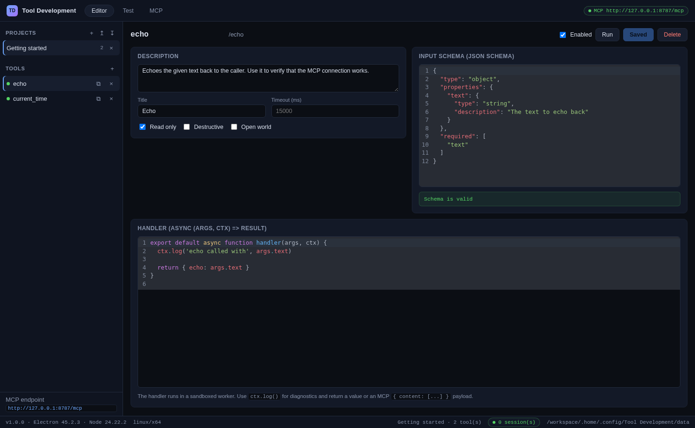

# Tools Development

A cross-platform desktop workbench for **authoring, testing and publishing MCP tools**.

Tools Development runs on Linux, WSL, Windows and macOS from the same codebase, and every
project you build is exposed over the **Model Context Protocol** so that _any_ MCP-capable
agent — Claude, Cursor, VS Code, Windsurf, Gemini CLI, Zed, or your own — can call your
tools immediately.



---

## Why it exists

Writing an MCP tool usually means hand-writing JSON schemas, debugging handler code in a
terminal, and then wiring the result into three different agent config files. Tool
Development turns that into one loop:

1. **Describe** the tool (name, description, JSON Schema) in a live editor.
2. **Run** it against real arguments inside a sandbox and read the logs.
3. **Publish** it over MCP — one URL (or one command) works with every agent.

---

## Features

|                       |                                                                                                                                                                             |
| --------------------- | --------------------------------------------------------------------------------------------------------------------------------------------------------------------------- |
| **Project workspace** | Multiple projects, each with its own tools, settings and allow-lists. Stored as plain JSON on disk — no database, no lock-in.                                               |
| **Tool editor**       | Live JSON Schema validation, syntax-highlighted handler editing, MCP annotations (`readOnlyHint`, `destructiveHint`, `openWorldHint`), per-tool timeouts.                   |
| **Sandboxed runner**  | Every handler executes in a separate `worker_thread` inside a `node:vm` context. Timeouts are enforced, `require` is allow-listed, and the real `process` is never exposed. |
| **Test console**      | Feed arguments as JSON, see the return value, the captured logs and the exact error — with timings.                                                                         |
| **MCP server**        | A built-in **Streamable HTTP** endpoint (`http://127.0.0.1:8787/mcp`) plus a **stdio** server for agents that spawn processes.                                              |
| **Agent presets**     | Ready-to-paste configuration for Claude Desktop, Claude Code, Cursor, VS Code, Windsurf, Continue, Gemini CLI, Zed and generic clients.                                     |
| **Live activity log** | Every `tools/list` and `tools/call` is logged with duration, status and result.                                                                                             |
| **Headless CLI**      | `tool-development mcp --stdio --project <path>` turns any folder into an MCP server for CI or headless agents.                                                              |

---

## Install

Download a build for your platform, or build it yourself (see [Development](#development)).

### Linux / WSL

```bash
# AppImage - no installation, works everywhere
chmod +x Tool-Development-1.0.0.AppImage
./Tool-Development-1.0.0.AppImage

# or Debian/Ubuntu package
sudo dpkg -i tool-development_1.0.0_amd64.deb
```

> **WSL:** the AppImage runs fine under WSLg. If you are using WSL1 or a headless setup,
> run the headless server instead — it needs no display at all:
>
> ```bash
> tool-development mcp --http --port 8787 --project ./my-project
> ```

### Windows

```powershell
# NSIS installer
Tools Development Setup 1.0.0.exe

# or the portable build
Tools Development 1.0.0.exe
```

### macOS

```bash
open "Tools Development-1.0.0.dmg"
```

---

## Connecting an agent

### Option A — the built-in HTTP endpoint (recommended)

Start the server in the app (**MCP → Start server**) or let it start automatically.
It listens on `http://127.0.0.1:8787/mcp` and speaks the Streamable HTTP transport.

Paste this into any agent that supports HTTP MCP servers:

```json
{
  "mcpServers": {
    "tool-development": {
      "type": "http",
      "url": "http://127.0.0.1:8787/mcp"
    }
  }
}
```

The **MCP** tab of the app generates this snippet pre-filled for Claude Desktop (macOS,
Windows, Linux), Claude Code, Cursor, VS Code, Windsurf, Continue, Gemini CLI and Zed.

### Option B — stdio (agents that spawn a process)

```json
{
  "mcpServers": {
    "tool-development": {
      "command": "tool-development",
      "args": ["mcp", "--stdio", "--project", "/absolute/path/to/project.json"]
    }
  }
}
```

Or from the command line:

```bash
tool-development mcp --stdio --project ~/projects/my-tools
```

### Option C — Claude Code

```bash
claude mcp add --transport http tool-development http://127.0.0.1:8787/mcp
```

---

## Writing a handler

A handler is a JavaScript function that receives the validated arguments and a small
context object:

```js
export default async function handler(args, ctx) {
  ctx.log("received", args);

  const response = await fetch("https://example.com/api", {
    method: "POST",
    body: JSON.stringify(args),
  });

  return { status: response.status, data: await response.json() };
}
```

### Accepted source forms

```js
export default async function handler(args, ctx) { /* ... */ }
export default async (args, ctx) => { /* ... */ }
module.exports = async (args, ctx) => { /* ... */ }
exports.default = async (args, ctx) => { /* ... */ }
async function handler(args, ctx) { /* ... */ }
async (args, ctx) => { /* ... */ }

// or a plain function body:
const total = args.a + args.b
return { total }
```

### Return values

| You return                          | The agent receives                                         |
| ----------------------------------- | ---------------------------------------------------------- |
| a string                            | a text content block                                       |
| an object / array                   | pretty-printed JSON as a text block                        |
| `{ content: [...] }`                | the content blocks verbatim (text, image, audio, resource) |
| `{ content: [...], isError: true }` | the content blocks flagged as an error                     |

### The `ctx` object

| Member                                              | Description                                                                 |
| --------------------------------------------------- | --------------------------------------------------------------------------- |
| `ctx.log(...)` / `ctx.warn(...)` / `ctx.error(...)` | Write to the log stream shown in the Test console and the MCP activity log. |
| `ctx.projectDir`                                    | Absolute path of the project directory.                                     |
| `ctx.env`                                           | The environment variables of the process.                                   |
| `ctx.require(id)`                                   | `require` with the project allow-list applied.                              |
| `ctx.shell(cmd, args)`                              | Runs a process — only available when the project enables `allowShell`.      |
| `ctx.fetch`                                         | The global `fetch` is already available.                                    |

---

## Sandbox and security

Tool code is **never** executed in the Electron main process:

- each run happens in its own `worker_thread`;
- the handler body is evaluated in a fresh `node:vm` context;
- `require` only resolves modules on the project allow-list (`node:path`, `node:url`,
  `node:util`, `node:os`, `node:crypto` by default);
- `child_process` is not reachable unless `allowShell` is switched on;
- the real `process` object is replaced by a limited shim;
- every run has a timeout (15 s by default) — a hanging handler is terminated;
- the worker heap is capped (`resourceLimits`).

The renderer runs with `contextIsolation: true`, `nodeIntegration: false` and a
`contextBridge`-only preload, and the MCP endpoint binds to `127.0.0.1` with an
origin allow-list.

---

## Project format

Projects are plain JSON and can be committed to git or shared with a teammate:

```json
{
  "id": "proj_8f3a1c2b",
  "name": "Getting started",
  "version": "0.1.0",
  "settings": {
    "allowModules": ["node:path", "node:fs"],
    "allowShell": false,
    "defaultTimeoutMs": 15000,
    "maxOutputBytes": 524288
  },
  "tools": [
    {
      "id": "tool_1a2b3c",
      "name": "echo",
      "description": "Echoes the given text back to the caller.",
      "inputSchema": {
        "type": "object",
        "properties": { "text": { "type": "string" } },
        "required": ["text"]
      },
      "handler": "export default async (args) => ({ echo: args.text })",
      "enabled": true,
      "annotations": { "title": "Echo", "readOnlyHint": true }
    }
  ]
}
```

Stored on disk in the platform data directory:

| Platform    | Location                                           |
| ----------- | -------------------------------------------------- |
| Linux / WSL | `~/.config/Tools Development/`                     |
| Windows     | `%APPDATA%\Tools Development\`                     |
| macOS       | `~/Library/Application Support/Tools Development/` |

The headless CLI uses `~/.tool-development/` unless `TOOL_DEVELOPMENT_DATA_DIR` is set.

---

## CLI reference

```text
tool-development mcp --stdio [--project <path>]      Serve MCP over stdio
tool-development mcp --http [--host <h>] [--port <n>] [--project <path>]
                                                        Serve MCP over Streamable HTTP
tool-development project list                         List the projects of the workspace
tool-development project new [name]                   Create a project
tool-development project export <id> <file>           Export a project as JSON
tool-development --help                               Show help
tool-development --version                            Print the version
```

`<path>` may point at a `project.json` file or at a directory containing one.

---

## Development

```bash
npm install          # installs dependencies and the Electron binary
npm run dev          # start the app with hot reload
npm run build        # build the main, preload, renderer and CLI bundles
npm test             # run the unit + MCP integration tests
npm run typecheck    # type-check the main and renderer code
npm run dist:linux   # AppImage + deb
npm run dist:win     # NSIS + portable exe
npm run dist:mac     # dmg + zip
```

### Project layout

```text
src/
  main/        Electron main process
    runner/    sandboxed execution (worker + handler compiler)
    mcp/       MCP registry, HTTP transport, stdio transport, agent presets
    service.ts application core shared by the GUI and the CLI
  preload/     contextBridge API
  renderer/    React UI (editor, test console, MCP panel)
  cli/         headless entry point
  shared/      types shared by every target
tests/         vitest suites, including real MCP client round-trips
```

### Tests

`npm test` runs 45 tests, including a full MCP round-trip against the real
`@modelcontextprotocol/sdk` client over **stdio** and **Streamable HTTP** — the same
client an agent would use.

---

## Troubleshooting

**"No project is open"** — the MCP endpoint serves the project selected in the app.
Open the project you want to publish in the sidebar.

**The agent cannot reach the endpoint** — check that the server is running in the
**MCP** tab and that the agent runs on the same machine. WSL2 agents running inside
the distro can reach the Windows host through `http://localhost:8787/mcp`.

**"Module X is not allowed"** — add the module to the project's _Allowed modules_
setting, or use `ctx.require()` with a relative path to a file in your project.

**A tool times out** — raise the per-tool timeout in the editor, or fix the handler.

---

## License

MIT

---

## Release metadata

`package.json` ships placeholder release metadata (`homepage`, `author.email`,
`repository`) because `electron-builder` refuses to build without them. Replace those
values with your own before publishing to a public channel.

## Built artifacts

`npm run dist:linux` produces three Linux packages in `release/`:

| Artifact                           | Notes                                                                   |
| ---------------------------------- | ----------------------------------------------------------------------- |
| `Tools Development-1.0.0.AppImage` | Portable, no installation required — also the easiest option under WSL. |
| `tool-development_1.0.0_amd64.deb` | Debian / Ubuntu package.                                                |
| `tool-development-1.0.0.tar.gz`    | Archive of the unpacked application.                                    |

The Windows (NSIS + portable) and macOS (dmg + zip) packages are produced by the same
`electron-builder` configuration on the matching runners — see
[`.github/workflows/release.yml`](.github/workflows/release.yml), which builds all three
platformes on every push.

The headless MCP server is shipped inside the application as well
(`resources/cli/index.js`), so an agent can be pointed at the installed application
without a separate Node installation:

```json
{
  "mcpServers": {
    "tool-development": {
      "command": "/path/to/Tools Development/resources/cli/index.js",
      "args": ["mcp", "--stdio", "--project", "/absolute/path/to/project.json"]
    }
  }
}
```
